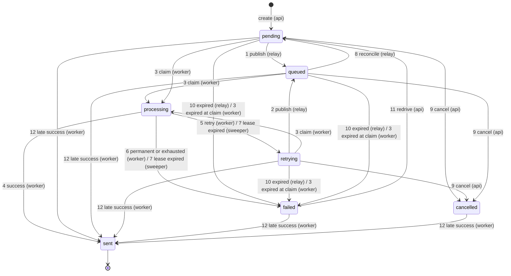

# ADR-0004: Data model, state machine and fencing

- **Status:** Accepted
- **Date:** 2026-11-18
- **Related:** [ADR-0002](0002-postgres-as-outbox-scheduler-and-retry-delay.md), [ADR-0003](0003-bounded-relay-buffer-and-sweepers.md), [ADR-0005](0005-service-topology-and-status-events.md), [ADR-0006](0006-api-contract-and-three-layer-idempotency.md), [ADR-0007](0007-retry-policy-and-circuit-breaker.md), [ADR-0008](0008-templates-and-scheduling.md)

## Context

Several processes act on the same notification concurrently: the api (create, cancel, redrive), the relay with its expiry pass, reconciliation and lease sweeper ([ADR-0003](0003-bounded-relay-buffer-and-sweepers.md)), and the workers. Delivery is at-least-once ([ADR-0002](0002-postgres-as-outbox-scheduler-and-retry-delay.md)), so a worker may receive a message that has already been handled, cancelled or expired, or a message whose row the relay has not yet committed as `queued`. Workers can also stall (GC pauses, network stalls) and resume after their work has been reassigned.

The data model must make these races safe **without distributed locks**, record every delivery attempt for visibility, and support listing with filters and pagination at a scale of millions of rows per day.

## Decision

### 1. Every transition is a single conditional `UPDATE`

Every race on a notification is decided by a conditional `UPDATE` on `notifications`: the `WHERE` clause states what must still be true, and a transition that affects zero rows means *"someone else got there first"*, which the caller handles explicitly. No lock is held across a network call, with one documented exception: the relay holds row locks while it publishes ([ADR-0002](0002-postgres-as-outbox-scheduler-and-retry-delay.md)). Every transition also:

- increments `version` (`version = version + 1`), which orders status events ([ADR-0005](0005-service-topology-and-status-events.md));
- sets `updated_at = now()` explicitly, with no trigger;
- returns a `StatusChanged` event, which the caller publishes after commit. The repository function signature is `(StatusChanged, error)`, so a transition cannot be written without producing its event.

### 2. States

| State | Meaning |
|---|---|
| `pending` | Accepted and waiting until `due_at`, which covers scheduled notifications |
| `queued` | Published to RabbitMQ |
| `processing` | Claimed by a worker, which holds a lease |
| `retrying` | Failed with a retryable outcome; waiting for its back-off `due_at` |
| `sent` | **The provider accepted it** (HTTP `2xx`). This does not mean it reached the end user. Terminal. |
| `failed` | Permanent error, retry budget exhausted, or expired. `failure_reason` holds the cause. |
| `cancelled` | Cancelled by the client |

**`failed` and `cancelled` are final for every actor except one.** A late result that proves the message was delivered moves the row to `sent` (transition 12). A client can therefore observe `cancelled → sent` or `failed → sent`; both are documented in the API ([ADR-0006](0006-api-contract-and-three-layer-idempotency.md) §7). A `failed` row can also be redriven (transition 11).

`delivered` is **reserved** for delivery receipts, which are [future work](../future-work.md). The name `accepted` was rejected for the success state because the API itself answers `202 Accepted` on creation, and the two meanings would collide.

`failure_reason` values: `provider_rejected`, `max_failures`, `max_failures_unknown_outcome`, `expired`, `internal_error`.

### 3. State machine



| # | Transition | Actor | Guard and side effects |
|---|---|---|---|
| 1 | `pending → queued` | relay | `due_at <= now()`, lane below its HWM, publish confirmed and not returned; sets `queued_at` ([ADR-0002](0002-postgres-as-outbox-scheduler-and-retry-delay.md), [ADR-0003](0003-bounded-relay-buffer-and-sweepers.md)) |
| 2 | `retrying → queued` | relay | Same as 1 |
| 3 | `pending`, `retrying` or `queued` `→ processing` | worker | The **claim** (below). Zero rows affected → ack and drop the message. |
| 4 | `processing → sent` | worker | Fencing guard (section 4); sets `provider_message_id`, `provider`, `sent_at` |
| 5 | `processing → retrying` | worker | `decideRetry` returns *retry*; sets `due_at = now() + delay`. `failures + 1` only for budget-consuming outcomes ([ADR-0007](0007-retry-policy-and-circuit-breaker.md)) |
| 6 | `processing → failed` | worker | `decideRetry` returns *fail* (permanent, budget exhausted, or the retry would fall after `expires_at`). `failures + 1` for budget-consuming outcomes, as in 5, so a row that exhausted its budget shows `failures = max_failures` |
| 7 | `processing → retrying` or `failed` | lease sweeper | `lease_expires_at < now()`. The attempt goes from `in_flight` to `unknown` with `finished_at = now()`, `failures + 1`, then `decideRetry`; all in one transaction ([ADR-0003](0003-bounded-relay-buffer-and-sweepers.md)) |
| 8 | `queued → pending` | relay (reconciliation), or the manual `requeue-stale` command | Runs on every relay (re)connection to RabbitMQ ([ADR-0003](0003-bounded-relay-buffer-and-sweepers.md)) |
| 9 | `pending`, `retrying` or `queued` `→ cancelled` | api | `status IN (...)`. A message already in RabbitMQ stays there, but its claim (3) affects zero rows and is dropped. **Cancel versus claim is therefore race-free without any coordination.** Cancel sets only `status` (with `version` and `updated_at`): nothing that transition 12 would have to undo, and `attempt_count` is untouched, which decides whether the `dedupe_key` is released. |
| 10 | `pending`, `retrying` or `queued` `→ failed` | relay | `expires_at <= now()`; `failure_reason = 'expired'` ([ADR-0002](0002-postgres-as-outbox-scheduler-and-retry-delay.md)) |
| 11 | `failed → pending` | api (redrive) | Resets `failures = 0` and `due_at = now()`, clears `failure_reason`. **`attempt_count` is never reset** (section 4). `expires_at` is kept unless it has passed (below). |
| 12 | `pending`, `queued`, `retrying`, `failed` or `cancelled` `→ sent` | worker (late) | `attempt_count = $n AND status IN ('pending','queued','retrying','failed','cancelled')`; sets `sent_at` and the provider fields, clears `failure_reason` (section 4) |

**The claim (transition 3).** The guard is:

```sql
WHERE id = $1
  AND status IN ('pending', 'retrying', 'queued')
  AND due_at <= now()
```

The guard accepts `pending` and `retrying` because a worker can receive a message before the relay has committed `queued` ([ADR-0002](0002-postgres-as-outbox-scheduler-and-retry-delay.md)). In that case the row is still locked by the relay's transaction: the `UPDATE` waits for the lock, re-evaluates its `WHERE` clause after the commit and claims the row. If the relay rolled back, the row is `pending` and due, and is claimed directly. `due_at <= now()` keeps a stale copy of a message from starting a retry before its back-off has elapsed.

The claim is **one statement**, a CTE that updates the row and opens the attempt:

```sql
WITH claimed AS (
  UPDATE notifications
  SET status           = CASE WHEN expires_at <= now() THEN 'failed' ELSE 'processing' END,
      failure_reason   = CASE WHEN expires_at <= now() THEN 'expired' END,
      attempt_count    = attempt_count + CASE WHEN expires_at <= now() THEN 0 ELSE 1 END,
      lease_expires_at = CASE WHEN expires_at <= now() THEN NULL ELSE now() + $2::interval END,
      updated_at = now(), version = version + 1
  WHERE id = $1
    AND status IN ('pending', 'retrying', 'queued')
    AND due_at <= now()
  RETURNING *
), attempt AS (
  INSERT INTO notification_attempts (notification_id, attempt_no, channel, provider, outcome, started_at)
  SELECT id, attempt_count, channel, $3, 'in_flight', now()
  FROM claimed
  WHERE status = 'processing'
)
SELECT * FROM claimed;
```

- **Expired at claim:** the same statement sets `failed / expired`, does **not** increment `attempt_count` and inserts **no** attempt row. Nothing is sent.
- **Zero rows:** the row was already claimed, cancelled, expired or sent, or it is not due. The worker acks and drops the message.
- A row claimed directly from `pending` or `retrying` has `queued_at = NULL`; metrics skip the queue-wait observation for it ([ADR-0009](0009-observability.md)). A transition to `retrying` (5, 7) clears `queued_at`, so the time of an earlier publish never survives into a later attempt.

**Cancel (transition 9) and an attempt of unknown outcome.** A row that was swept back to `retrying` (transition 7) and is then cancelled is represented as: `status = 'cancelled'`, `attempt_count >= 1`, `failure_reason` and `sent_at` `NULL`, and its attempt row still `outcome = 'unknown'` with `finished_at` set. "May have been sent" is not a column: the API derives it from the attempt row ([ADR-0006](0006-api-contract-and-three-layer-idempotency.md) §7). When the late result arrives, the worker overwrites the attempt's `unknown` with the true outcome and transition 12 moves the row to `sent`; there is no cancel-specific state to clear, and the `dedupe_key` was never released, because `attempt_count > 0`.

**Redrive (transition 11).** If the stored `expires_at` is still in the future, it is kept. If it has passed, the request must supply a new `expires_at` at least 30 seconds ahead; without one the call returns `409` ([ADR-0006](0006-api-contract-and-three-layer-idempotency.md) §7). A client-supplied expiry is never silently replaced, and a request that supplies one while the stored one is still valid is refused. Both rules are part of the guard of the one `UPDATE`, evaluated on the database clock, so a redriven row is never already expired. The transition also clears `queued_at`, like every transition to a state from which the row is published again. Attempt numbers keep increasing across redrives, so the attempt history stays unique.

### 4. Lease and fencing token

A **slow worker is not a dead worker.** A worker can stall past its lease, have its notification reclaimed by the lease sweeper, and then wake up holding a result. Without protection it would overwrite the state of a newer attempt.

- **Lease:** `lease_expires_at`, set at claim time to 30 seconds. It covers the wait for the send after the claim, the HTTP timeout (10 s) and a margin for the final write. The wait is bounded by the worker's send deadline, `lease − HTTP timeout − 5 s` from issuing the claim call ([ADR-0007](0007-retry-policy-and-circuit-breaker.md) §5); `now()` is the start of the claim statement, so a claim that waited on a row lock has a lease that is shorter by that wait, which the deadline accounts for.
- **Fencing token:** `attempt_count`. It increases only at claim time, so its value identifies exactly one attempt. Final writes are conditional on it:

```sql
UPDATE notifications
SET status = 'sent', provider_message_id = $3, provider = $4, sent_at = now(),
    lease_expires_at = NULL, updated_at = now(), version = version + 1
WHERE id = $1 AND status = 'processing' AND attempt_count = $2;
```

- **The lease is cleared when the row leaves `processing`** (transitions 4, 5, 6 and 7), so `lease_expires_at` is set only on a `processing` row.
- **A late worker's write affects zero rows.** Its attempt row is still updated with the true outcome ([section 6](#6-tables)), so no information is lost.
- **Late success (transition 12):** only a claim increments `attempt_count`. So `attempt_count = $n` means *"no newer attempt has started since mine"*. If the late worker succeeded and the row is in any state other than `processing` or `sent`, the message was delivered and the row moves to `sent`. This covers a row that the lease sweeper returned to `retrying`, that the relay republished (`queued`) or reconciled (`pending`), that exhausted its budget or expired (`failed`), or that the client cancelled in the meantime. A copy still in RabbitMQ is then dropped by its claim guard. In the most common stall scenario this prevents a duplicate send.
- **The final write is retried.** If Postgres is unavailable when the provider has answered, the worker retries its final write with back-off for up to **60 seconds**: transition 4 first, and transition 12 if that affects zero rows. After that the result is lost to the row, the lease sweeper marks the attempt `unknown`, and the notification is retried; this is one of the windows in which a duplicate send can occur.
- **The fencing token must be monotonic.** If redrive reset `attempt_count`, a token could repeat and a very old late worker could match a new attempt. That is why redrive resets `failures` and never `attempt_count`.

### 5. Retry decisions: one function

Transitions 5, 6 and 7 all use one function in the I/O-free `domain/` package ([ADR-0005](0005-service-topology-and-status-events.md)):

```go
decideRetry(outcome Outcome, failures, maxFailures int, expiresAt time.Time,
            retryAfter time.Duration, profile Profile, now time.Time, jitter float64) Decision
// Decision{Action: Retry | Fail, Delay, Reason, ConsumesBudget}
```

- `failures` is the number of budget-consuming failures recorded on the row **before** the current outcome; the function adds the current one. The row fails when that total reaches `max_failures`, so `max_failures` is the total number of budget-consuming failures a notification may have ([ADR-0007](0007-retry-policy-and-circuit-breaker.md) §3).
- It is exported from `domain/` as `DecideRetry`, because the repository functions of transitions 5, 6 and 7 call it inside their transaction.
- It encodes the budget, the expiry shortcut (fail immediately if `now + Delay >= expiresAt`) and `Retry-After` handling ([ADR-0007](0007-retry-policy-and-circuit-breaker.md)).
- **It is deterministic.** The random part of full jitter is passed in as `jitter`, a number in `[0, 1)`, so the function can be table-tested exhaustively.
- **It returns a delay, not a timestamp.** The caller passes the database `now()` read in the same transaction, and `due_at = now() + delay` is computed in SQL. Scheduling uses one clock ([ADR-0002](0002-postgres-as-outbox-scheduler-and-retry-delay.md)).

### 6. Tables

#### `notifications`

One table holds both the immutable request and the changing delivery state.

| Column | Type | Notes |
|---|---|---|
| `id` | `uuid` PK | **UUIDv7**, generated in Go with `google/uuid`. Time-ordered for index locality |
| `batch_id` | `uuid NULL` | FK → `batches` |
| `dedupe_key` | `text NULL` | Record-level idempotency ([ADR-0006](0006-api-contract-and-three-layer-idempotency.md)) |
| `channel` | `text` | `CHECK IN ('sms','email','push')` |
| `priority` | `smallint` | 0 = high, 1 = normal, 2 = low, so ordering works naturally |
| `recipient`, `content` | `text` | `content` is **rendered at creation time** ([ADR-0008](0008-templates-and-scheduling.md)) |
| `sms_encoding`, `sms_segments` | `text NULL`, `smallint NULL` | `GSM-7` or `UCS-2`, and the segment count ([ADR-0006](0006-api-contract-and-three-layer-idempotency.md)) |
| `template_name`, `template_version`, `template_vars` | `text NULL`, `int NULL`, `jsonb NULL` | Provenance |
| `status`, `failure_reason` | `text`, `text NULL` | `CHECK` constraints (below) |
| `due_at` | `timestamptz` | The relay's only scheduling key |
| `scheduled_at` | `timestamptz NULL` | The client's requested delivery time |
| `expires_at` | `timestamptz NOT NULL` | **Always set**; defaults from the priority profile ([ADR-0007](0007-retry-policy-and-circuit-breaker.md)) |
| `attempt_count` | `int` | Fencing token; increments only on claim |
| `failures`, `max_failures` | `int` | Retry budget |
| `queued_at` | `timestamptz NULL` | Set by the relay; `NULL` for rows claimed directly |
| `lease_expires_at` | `timestamptz NULL` | Used by the lease sweeper |
| `provider`, `provider_message_id` | `text NULL` | Which provider accepted the message. `provider_message_id` is **not** assumed to be unique. |
| `correlation_id`, `trace_parent` | `text` | Request correlation and trace context, stored because the relay is asynchronous ([ADR-0009](0009-observability.md)). Both are `NOT NULL`; `trace_parent` defaults to the empty string for a request without trace context |
| `version` | `bigint` | Strictly monotonic per row; orders status events |
| `created_at`, `updated_at`, `sent_at` | `timestamptz` | |

There is no `subject` column. The assessment defines a notification as recipient, channel, content and priority; a subject or title is [future work](../future-work.md) for real provider integrations.

**Immutable after insert:** `id`, `batch_id`, `dedupe_key`, `channel`, `priority`, `recipient`, `content`, `template_*`, `scheduled_at`, `created_at`, `correlation_id`, `trace_parent`. The repository has no statement that updates them, and a test asserts that none of the 12 transitions touches them.

**Invariants enforced by the database:**

| Invariant | Mechanism |
|---|---|
| `status = 'failed'` ⇔ `failure_reason IS NOT NULL` | `CHECK` |
| `status = 'sent'` ⇔ `sent_at IS NOT NULL` | `CHECK` |
| At most one `in_flight` attempt per notification | Partial unique index on `notification_attempts (notification_id) WHERE outcome = 'in_flight'` |
| An attempt has no `finished_at` ⇔ it is `in_flight` | `CHECK` on `notification_attempts` |

There is deliberately no free-text error column on `notifications`. Provider error bodies, redacted, live only in `notification_attempts.error` ([ADR-0009](0009-observability.md)).

#### `notification_attempts` (one row per attempt)

| Column | Type | Notes |
|---|---|---|
| `notification_id`, `attempt_no` | `uuid`, `int` | `UNIQUE (notification_id, attempt_no)`, implemented as the table's primary key; `attempt_no` equals the `attempt_count` at claim time |
| `channel`, `provider` | `text` | Denormalised (immutable) so the metrics summary avoids a join ([ADR-0009](0009-observability.md)) |
| `outcome` | `text` | `CHECK IN ('in_flight', 'success', 'retryable', 'permanent', 'provider_fatal', 'throttled', 'unknown', 'unreachable', 'aborted', 'internal_error')` ([ADR-0007](0007-retry-policy-and-circuit-breaker.md) §2) |
| `http_status`, `latency_ms` | `int NULL` | |
| `error` | `text NULL` | Provider body with known values redacted, truncated to 1 KB |
| `provider_message_id` | `text NULL` | |
| `started_at` | `timestamptz` | Set at claim time |
| `finished_at` | `timestamptz NULL` | `NULL` only while the attempt is `in_flight` |

The row is **opened at claim time** as `in_flight` (transition 3) and later updated, never inserted twice:

| Writer | Statement |
|---|---|
| Worker (normal path) | `UPDATE ... SET outcome = $x, finished_at = now() ... WHERE outcome IN ('in_flight', 'unknown')` |
| Lease sweeper | `UPDATE ... SET outcome = 'unknown', finished_at = now() WHERE outcome = 'in_flight'` |

A late worker therefore overwrites `unknown` with the **true** outcome, including the `provider_message_id`. The audit trail stays correct without `ON CONFLICT` tricks, and in-flight attempts can be queried.

#### Supporting tables

| Table | Purpose | Defined in |
|---|---|---|
| `batches` | `id`, `total`, `accepted`, `rejected`, `correlation_id`, `created_at`; per-status counts are computed with `GROUP BY` | [ADR-0006](0006-api-contract-and-three-layer-idempotency.md) |
| `idempotency_keys` | `key` PK, `request_hash`, `response_status`, `response_body jsonb`, `created_at`, `expires_at` | [ADR-0006](0006-api-contract-and-three-layer-idempotency.md) |
| `templates`, `template_versions` | Immutable versioned templates | [ADR-0008](0008-templates-and-scheduling.md) |

### 7. Indexes

| Index | Used by |
|---|---|
| `notifications (channel, priority, due_at) WHERE status IN ('pending','retrying')` | Relay lane selection |
| `notifications (channel, priority, queued_at) WHERE status = 'queued'` | HWM count, oldest-queued age, reconciliation |
| `notifications (lease_expires_at) WHERE status = 'processing'` | Lease sweeper |
| `notifications (expires_at) WHERE status IN ('pending','retrying','queued')` | Expiry pass |
| `notifications (created_at DESC, id DESC)` | Listing and keyset pagination |
| `notifications (status, created_at DESC, id DESC)` | Listing filtered by status. Whether a channel index is also needed is decided with `EXPLAIN` on realistic data, and the check is tied to a test ([ADR-0010](0010-testing-and-ci.md)) |
| `notifications (batch_id) WHERE batch_id IS NOT NULL` | Batch queries and batch cancel |
| `UNIQUE notifications (dedupe_key) WHERE dedupe_key IS NOT NULL AND NOT (status = 'cancelled' AND attempt_count = 0)` | Record-level idempotency ([ADR-0006](0006-api-contract-and-three-layer-idempotency.md) §11). Every `ON CONFLICT` repeats this predicate. |
| `UNIQUE notification_attempts (notification_id, attempt_no)` | Attempt integrity |
| `UNIQUE notification_attempts (notification_id) WHERE outcome = 'in_flight'` | At most one open attempt |
| `notification_attempts (channel, finished_at)` | Metrics summary ([ADR-0009](0009-observability.md)) |
| `idempotency_keys (expires_at)` | Cleanup |

### 8. Storage choices

- **`text` + `CHECK` instead of Postgres enums.** Values cannot be removed from an enum, which makes migrations awkward.
- **Autovacuum tuning.** `status` appears in partial-index predicates, so status changes can never be HOT updates. Each notification is updated at least three times, which is about 900 dead tuples per second at full throughput. The migration sets `autovacuum_vacuum_scale_factor = 0.02` on `notifications` and on `notification_attempts`.
- **Migrations** use `golang-migrate`, with versioned `up` and `down` SQL files. CI runs an `up → down → up` round trip ([ADR-0010](0010-testing-and-ci.md)). `sqlc` reads the schema from the same directory.

### 9. Two layers of dead letters

| Layer | Contains | Recovery |
|---|---|---|
| **Logical DLQ:** `status = 'failed'` in Postgres | Every notification that failed by business rules | Redrive (transition 11) |
| **Broker DLQ:** `dispatch.{channel}.poison` | Messages the broker dead-lettered after its delivery limit. A safety net: the worker acks right after the claim, so the real defence against a message that keeps crashing workers is the `failures` budget and the lease sweeper ([ADR-0001](0001-rabbitmq-as-dispatch-broker.md)) | Inspection. The row of a dead-lettered message stays `queued` and is recovered by reconciliation or the manual `requeue-stale` command ([ADR-0003](0003-bounded-relay-buffer-and-sweepers.md)) |

## Alternatives considered

| Alternative | Why it was rejected |
|---|---|
| **Claim guard `status = 'queued'` only** | The relay publishes before it commits `queued`. A worker that receives the message first would see `pending`, match zero rows without waiting, and ack and drop the message; the row would then be `queued` with no message. This is most likely on an idle system. |
| **Late success only from `retrying` and `queued`** | A delivered message could stay `failed` (budget exhausted or expired while the worker was stalled) or `cancelled`, and a row reconciled to `pending` would be sent again. The status would then contradict what happened at the provider. |
| **Redrive always renews `expires_at` from the priority profile** | Overwrites a deadline the client chose. A one-time password redriven an hour later would be sent after it stopped being useful. |
| **Detect stuck rows with `updated_at`** | Cannot distinguish a slow worker from a dead one; a late writer overwrites newer state (section 4). |
| **Order events by `updated_at`** | `now()` returns the *transaction start* time. A transaction that starts first and waits on a row lock commits later but carries an earlier timestamp. |
| **Order events by `(attempt_count, state rank)`** | The state machine has cycles (8, 11, retries) and redrive resets counters, so a rank is not monotonic. |
| **`ON CONFLICT DO NOTHING` for attempt rows** | Discards the late worker's true outcome and `provider_message_id`, which is exactly the information needed to avoid a duplicate. |
| **Split the changing status columns into a narrow table** | At 294 msg/s and a handful of updates per notification, the write volume is small for Postgres, and the split would cost a join on every listing query. It becomes worthwhile at a much larger scale and is recorded in [future work](../future-work.md). |
| **A `subject` column** | Not part of the notification the assessment defines, and the provider request has no field for it ([ADR-0007](0007-retry-policy-and-circuit-breaker.md) §6). A stored but unused field would be worse than none. |
| **Time-based partitioning** | The right move for long-term retention, but a unique index on a partitioned table must include the partition key, which breaks the `dedupe_key` uniqueness. Deferred to [future work](../future-work.md). |
| **Separate `outbox` table** | See [ADR-0002](0002-postgres-as-outbox-scheduler-and-retry-delay.md). |

## Consequences

**Positive**

- Relay versus worker, cancel versus claim, duplicate messages, sweeper versus worker, and late workers are all resolved by single-statement guards, without distributed locks.
- Every attempt is recorded with its true outcome, which satisfies the delivery-visibility requirement (R6).
- The status always converges on what happened at the provider: a delivered message ends as `sent` even if the result arrives late.
- Status events can be ordered reliably by clients ([ADR-0005](0005-service-topology-and-status-events.md)).
- Retry logic is concentrated in one deterministic, testable function.

**Negative / costs**

- `failed` and `cancelled` are not strictly terminal. API consumers must accept a later `sent`.
- Several updates per notification cause bloat; autovacuum must keep up and is tuned accordingly.
- The partial and composite indexes add write cost. Each one is justified by a specific query, and listing indexes are validated with `EXPLAIN`.
- The model relies on discipline: every transition must go through the repository functions. Tests enforce the event, the `version` increment and column immutability.
- Without partitioning, retention (deleting old rows) is future work.

## Review history

Changes made after the design review, recorded in the [design review log](../ai/design-review-log.md):

- The claim guard was widened from `status = 'queued'` to the three pre-claim states with `due_at <= now()`, and the claim became one CTE statement; the narrow guard dropped messages when a worker was faster than the relay's commit. (D1)
- Transition 12 now also applies from `pending`, `failed` and `cancelled`, so a delivered message always ends as `sent`; `failed` and `cancelled` are therefore not strictly terminal. (D14)
- Redrive keeps the stored `expires_at` and asks for a new one only when it has passed; the dedupe index keeps a cancelled notification's key when an attempt was made. (D16, D15)
- `decideRetry` takes the jitter as an argument and returns a delay; the worker's final write is retried for up to 60 seconds. (D17, D18)
- Database-level invariants were added, `subject` was removed, the stale sweeper's transition 8 became reconciliation, and the one-table rationale no longer relies on TOAST. (D19, D22, D5, D21)
