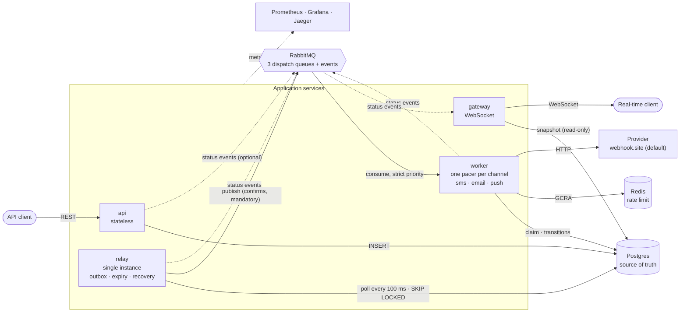
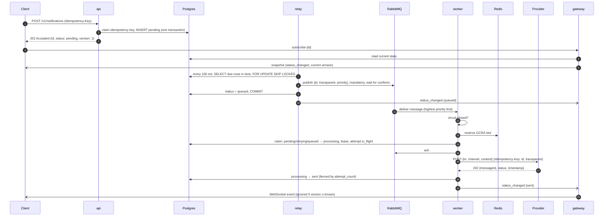
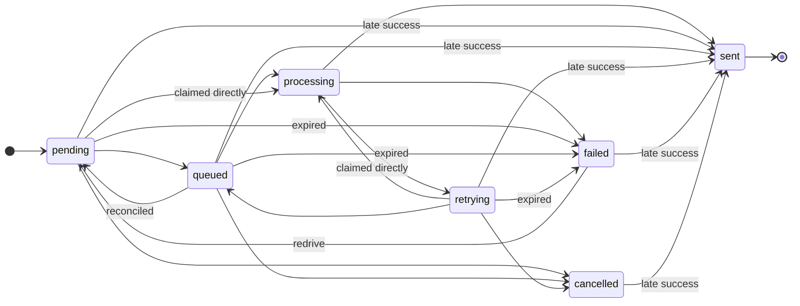

# Architecture

This document describes the system as it is implemented. It was brought in line with the code at the end of the project (2026-11-20) in a consistency pass, not rewritten: the rate, the ports, the services, the versions and the provider client's rule for a written request are the implemented ones.

An event-driven notification service that accepts SMS, Email and Push notifications through a REST API and delivers them asynchronously through an external provider, with:

- a rate limit of at most **100 messages per second per channel**;
- strict priority;
- intelligent retries;
- status updates in real time.

This document is the entry point. It gives the overall picture; every decision is explained in an [Architecture Decision Record](#architecture-decision-records), including the alternatives that were rejected and why. Known limitations, the interpretations adopted where the requirements are open, and deferred items are listed in [future work](future-work.md).

## Design principles

1. **Postgres is the source of truth.** Every notification, its state and its full attempt history live in Postgres. The broker only carries pointers to work that is ready now.
2. **The backlog lives in the database, not the broker.** Bursts are expected by design (see [Bursts and backpressure](#bursts-and-backpressure)); RabbitMQ holds a small, bounded buffer.
3. **Every race on a notification is decided by a conditional `UPDATE` on `notifications`.** No guarantee depends on a process being the only one of its kind, so there is no leader election and no distributed lock.
4. **Failures are classified by scope.** A failure that is certainly the provider's (credentials, throttling, an unreachable host) opens a circuit and consumes no message's retry budget. A failure that may be the message's (a `5xx`, an ambiguous timeout) consumes that message's budget and counts toward the circuit.
5. **Every claim names its evidence.** The rate limit and loss-free delivery are measured at the provider and the results are published; priority and channel isolation are tested stage by stage, not measured under load ([load-test results](load-test.md)); seven of the guarantees are checked by mutation (`make verify-suite`). Where a measurement was intended and not made, the documents say so.

## Requirements map

Requirements are numbered R1 to R36 and paraphrased here. This table says where each one is addressed; **the tests and commands that demonstrate each one are in the [README's requirements map](../README.md#requirements-map).**

| ID | Requirement | Where it is addressed |
|---|---|---|
| R1 | Three channels: SMS, Email, Push | [ADR-0005](adr/0005-service-topology-and-status-events.md), [ADR-0006](adr/0006-api-contract-and-three-layer-idempotency.md) §5 |
| R2 | High volume, millions of notifications per day | [ADR-0001](adr/0001-rabbitmq-as-dispatch-broker.md): 291 msg/s, about 25.1 M per day |
| R3 | Burst traffic | [ADR-0003](adr/0003-bounded-relay-buffer-and-sweepers.md): HWM and backpressure |
| R4 | Reliable delivery | [ADR-0002](adr/0002-postgres-as-outbox-scheduler-and-retry-delay.md), [ADR-0003](adr/0003-bounded-relay-buffer-and-sweepers.md), [ADR-0004](adr/0004-data-model-state-machine-and-fencing.md) |
| R5 | Intelligent retries | [ADR-0007](adr/0007-retry-policy-and-circuit-breaker.md) §1–4, §7 |
| R6 | Visibility of delivery status; real-time tracking | [ADR-0004](adr/0004-data-model-state-machine-and-fencing.md) §6 (attempt history), [ADR-0005](adr/0005-service-topology-and-status-events.md), [ADR-0009](adr/0009-observability.md) |
| R7 | Implemented in Go 1.2x | Go 1.27 (the code generator needs 1.26 or later) |
| R8 | Create a notification with recipient, channel, content and priority | [ADR-0006](adr/0006-api-contract-and-three-layer-idempotency.md) §2–5 |
| R9 | Batch creation, up to 1,000 per request | [ADR-0006](adr/0006-api-contract-and-three-layer-idempotency.md) §6: partial success |
| R10 | Query status by ID | [ADR-0006](adr/0006-api-contract-and-three-layer-idempotency.md) §2 |
| R11 | Query status by batch ID | [ADR-0006](adr/0006-api-contract-and-three-layer-idempotency.md) §2 |
| R12 | Cancel pending notifications | [ADR-0004](adr/0004-data-model-state-machine-and-fencing.md) transition 9; [ADR-0006](adr/0006-api-contract-and-three-layer-idempotency.md) §7 |
| R13 | List with filters (status, channel, date range) and pagination | [ADR-0006](adr/0006-api-contract-and-three-layer-idempotency.md) §8: keyset cursor |
| R14 | Asynchronous processing by queue workers | [ADR-0001](adr/0001-rabbitmq-as-dispatch-broker.md), [ADR-0005](adr/0005-service-topology-and-status-events.md) |
| R15 | At most 100 messages per second per channel | [ADR-0007](adr/0007-retry-policy-and-circuit-breaker.md) §5: GCRA at 97 msg/s, zero burst |
| R16 | Priority queue (high, normal, low) | [ADR-0001](adr/0001-rabbitmq-as-dispatch-broker.md): strict priority in quorum queues; [ADR-0003](adr/0003-bounded-relay-buffer-and-sweepers.md): HWM per lane |
| R17 | Content validation (character limits, required fields) | [ADR-0006](adr/0006-api-contract-and-three-layer-idempotency.md) §5: per channel, after rendering |
| R18 | Idempotency to prevent duplicate sends | [ADR-0006](adr/0006-api-contract-and-three-layer-idempotency.md) §11: request, record and send layers |
| R19 | Delivery and retry logic, designed by the candidate | [ADR-0007](adr/0007-retry-policy-and-circuit-breaker.md); [ADR-0004](adr/0004-data-model-state-machine-and-fencing.md) |
| R20 | Real-time metrics endpoint: queue depth, success and failure rates, latency | [ADR-0009](adr/0009-observability.md) §1–2: `GET /v1/metrics/summary` and Prometheus |
| R21 | Structured logging with correlation IDs | [ADR-0009](adr/0009-observability.md) §4–5 |
| R22 | Health check endpoint | [ADR-0009](adr/0009-observability.md) §7: on the api's public port |
| R23 | Use webhook.site as the provider, with the given request format | [ADR-0007](adr/0007-retry-policy-and-circuit-breaker.md) §6; [ADR-0005](adr/0005-service-topology-and-status-events.md) |
| R24 | Expected response: `202` with `messageId`, `status`, `timestamp` | [ADR-0007](adr/0007-retry-policy-and-circuit-breaker.md) §2, §6 |
| R25 | **Bonus:** failure handling | [ADR-0007](adr/0007-retry-policy-and-circuit-breaker.md) §1, §7, §9–10; [ADR-0003](adr/0003-bounded-relay-buffer-and-sweepers.md) |
| R26 | **Bonus:** scheduled notifications | [ADR-0008](adr/0008-templates-and-scheduling.md); [ADR-0002](adr/0002-postgres-as-outbox-scheduler-and-retry-delay.md) |
| R27 | **Bonus:** template system with variable substitution | [ADR-0008](adr/0008-templates-and-scheduling.md) |
| R28 | **Bonus:** WebSocket updates | [ADR-0005](adr/0005-service-topology-and-status-events.md); [ADR-0006](adr/0006-api-contract-and-three-layer-idempotency.md) §10 |
| R29 | **Bonus:** distributed tracing | [ADR-0009](adr/0009-observability.md) §6 |
| R30 | **Bonus:** GitHub Actions CI/CD | [ADR-0010](adr/0010-testing-and-ci.md) §5: the CI workflow. The release workflow of §6 was not built |
| R31 | Source repository with a clean commit history | [ADR-0010](adr/0010-testing-and-ci.md) §7 |
| R32 | README with setup instructions, architecture overview and API examples | README; this document |
| R33 | Docker Compose, one-command setup | [ADR-0005](adr/0005-service-topology-and-status-events.md) |
| R34 | Swagger/OpenAPI documentation | [ADR-0006](adr/0006-api-contract-and-three-layer-idempotency.md) §1 |
| R35 | Versioned database migrations | [ADR-0004](adr/0004-data-model-state-machine-and-fencing.md) §8 |
| R36 | Test suite runnable with a single command | [ADR-0010](adr/0010-testing-and-ci.md) §4 |

## System overview



| Service | Role | Instances in Compose | Required dependencies | ADR |
|---|---|---|---|---|
| **api** | REST, validation, template rendering, cancel, redrive, listing, metrics summary, health endpoints | 1, stateless | Postgres only | [0006](adr/0006-api-contract-and-three-layer-idempotency.md) |
| **relay** | Publishes due rows (new, scheduled, retries) on a 100 ms ticker, enforces lane HWMs, expires rows, reconciles on reconnection, recovers stuck work | 1, restarted by the runtime | Postgres, RabbitMQ | [0002](adr/0002-postgres-as-outbox-scheduler-and-retry-delay.md), [0003](adr/0003-bounded-relay-buffer-and-sweepers.md), [0005](adr/0005-service-topology-and-status-events.md) |
| **worker** | Pacing, rate limiting, circuit breaking, provider calls, delivery transitions | 1 container for all channels (an override runs one per channel, with the mock profile) | Postgres, RabbitMQ; Redis with a fallback | [0005](adr/0005-service-topology-and-status-events.md), [0007](adr/0007-retry-policy-and-circuit-breaker.md) |
| **gateway** | WebSocket: snapshot on subscribe and fan-out of status events | 1 | RabbitMQ, Postgres (read-only) | [0005](adr/0005-service-topology-and-status-events.md) |
| **migrate** | Applies migrations, then exits | One-shot | Postgres | [0004](adr/0004-data-model-state-machine-and-fencing.md) |
| **mockprovider** | Fault-injecting fake provider for the mock profile (`make up-mock`), the automated tests and the load runs; not the default target | Mock profile and tests only | — | [0010](adr/0010-testing-and-ci.md) |

**Ports.** Only five host ports are published, each changeable with a variable: the api on 8080 (`API_PORT`), the gateway on 8082 (`GATEWAY_PORT`), Grafana on 3000, Prometheus on 9090 and the Jaeger UI on 16686; `mockprovider` adds 8090 in the mock profile. Every application service also serves `/metrics`, `/healthz`, `/readyz` and `pprof` on an admin port, 8081, which is not published; Prometheus scrapes it inside the Compose network. Postgres, RabbitMQ and Redis publish no host port.

**Observability as built.** `GET /v1/metrics/summary` on the api gives queue depth, success and failure rates and latency as JSON, computed from the database. The roles export Prometheus metrics for ingest, lane depth and backlog, attempts by outcome, latencies, circuit state, rate-limit wait and missed pacer slots, expiry, the sweepers and reconciliation, and the gateway's connections; one Grafana dashboard ("Overview") and six alert rules are provisioned. Logs are JSON lines with correlation ids and never carry a recipient or content; a request is one trace from the api to the provider call ([ADR-0009](adr/0009-observability.md)).

## Lifecycle of a notification



If the worker receives the message before the relay's commit, its claim waits on the row lock and succeeds after the commit ([ADR-0004](adr/0004-data-model-state-machine-and-fencing.md), transition 3).

The full state machine, with all 12 transitions and their guards, is in [ADR-0004](adr/0004-data-model-state-machine-and-fencing.md):



`failed` and `cancelled` are final except for a late success: a result that arrives after its lease expired and proves the message was delivered moves the row to `sent` (transition 12).

## Bursts and backpressure

| Quantity | Value |
|---|---|
| Pacing rate | 97 msg/s per channel, chosen so that no one-second window at the provider exceeds 100. Measured: 98 on an idle machine, and 102 in one load run on a machine doing other work ([load-test results](load-test.md)); the limit applies to when a send starts |
| Delivery capacity | 3 channels × 97 msg/s = **291 msg/s**, about **25.1 M per day** |
| 1 M SMS burst | About 2.9 hours to drain through the SMS channel |
| RabbitMQ buffer | At most 2,000 distinct notifications per channel (HWM per lane: high 500, normal 1,000, low 500), about 21 seconds of work; duplicates possible |
| Largest burst a channel can drain within the default TTL | `high` (10 min) ≈ 58,200; `normal` (6 h) ≈ 2.1 M; `low` (24 h) ≈ 8.4 M |

The burst backlog waits in Postgres. When a provider fails, the system slows down step by step without explicit coordination:

```
provider fails → circuit opens → the pacer stops claiming → messages wait in the queue
→ lanes reach their HWM → relay stops publishing → backlog grows in Postgres → expired rows fail
```

Priority holds under backlog for two reasons: the relay keeps headroom for each priority (HWM per lane) and visits `high` first, and the broker delivers by strict priority within each channel's queue. Under sustained `high` traffic at a channel's full rate, `low` waits ([ADR-0001](adr/0001-rabbitmq-as-dispatch-broker.md), [ADR-0003](adr/0003-bounded-relay-buffer-and-sweepers.md)).

The backlog in Postgres is not limited; a notification's expiry time is the only bound.

## Delivery semantics

Delivery is **at-least-once**. Duplicates are prevented where the system can prevent them, and measured where it cannot:

| Duplicate source | Defence |
|---|---|
| Client retries the HTTP request | `Idempotency-Key`: the stored response is replayed ([ADR-0006](adr/0006-api-contract-and-three-layer-idempotency.md)) |
| The same business event in different requests | `dedupe_key`, unique unless cancelled before any attempt ([ADR-0006](adr/0006-api-contract-and-three-layer-idempotency.md)) |
| Duplicate messages from republishing or reconciliation | Conditional claim: only one copy is processed ([ADR-0004](adr/0004-data-model-state-machine-and-fencing.md)) |
| A stalled worker resuming after its lease expired | The fencing token rejects its write; a late success moves the row to `sent` instead of resending ([ADR-0004](adr/0004-data-model-state-machine-and-fencing.md)) |
| The HTTP client repeating a request | Redirects are not followed and transport replays are disabled ([ADR-0007](adr/0007-retry-policy-and-circuit-breaker.md) §11) |
| An attempt whose result is unknown | Retried with `Idempotency-Key: <notification_id>` to the provider ([ADR-0007](adr/0007-retry-policy-and-circuit-breaker.md) §6) |

**Every attempt that ends `unknown` can produce a duplicate with a provider that ignores idempotency keys, and webhook.site does.** An attempt ends `unknown` after a timeout or a broken connection that follows a written request, when a worker dies after the provider answered, or when a database outage outlasts the worker's final-write retries. **A request counts as written once the HTTP transport has read its body to the end and no failed write was reported;** before that the attempt is `unreachable`, which consumes no retry budget. The rule errs towards `unknown` ([ADR-0007](adr/0007-retry-policy-and-circuit-breaker.md) §2). The load and chaos tests count duplicates at the provider and report them ([load-test results](load-test.md#chaos-scenarios)): none outside the scenario that kills the worker mid-send, where the 20 to 25 sends in flight were repeated once each.

## Failure handling

| Failure | Effect | Recovery | Chaos scenario |
|---|---|---|---|
| RabbitMQ down | The api keeps accepting; the backlog grows in Postgres | The relay reconnects, reconciles and republishes | Yes |
| RabbitMQ loses its data | Queued messages are gone; topology is gone | Every role redeclares the topology; reconciliation returns `queued` rows to `pending` | Yes |
| Postgres down | Requests return `503`; workers cannot claim; final writes are retried for 60 s | Automatic once it returns; sends finished during a long outage may be repeated | Yes |
| Redis down | The worker switches to an in-process limiter; the rate limit is approximate | Automatic | Yes |
| Provider failing | Circuit opens; retry budgets are preserved | Half-open probes close the circuit | Yes |
| Provider unreachable at low traffic | Circuit opens after 5 consecutive failures; no budget is consumed | Half-open probes | Yes |
| Worker killed mid-send | Row stuck in `processing` | Lease sweeper (transition 7) | Yes |
| Relay stopped | Publishing, expiry and recovery pause; nothing is lost | Restarted by the container runtime | No (start-up path covered by integration tests) |
| Message lost while the relay stays connected | Row stays `queued` | Oldest-queued-age alert, manual `requeue-stale`, or expiry | No |
| Unroutable publish | Row stays `pending` | Topology is redeclared on connection; published on a later cycle | No (integration test) |
| webhook.site URL expired or capped | Circuit opens (provider-scoped) | Create a new URL and set `PROVIDER_URL` | No |

Details: [ADR-0007](adr/0007-retry-policy-and-circuit-breaker.md) §10. The last column says which rows have a chaos scenario in [ADR-0010](adr/0010-testing-and-ci.md) §1; the others are covered by integration tests or are operational procedures.

## Technology

Every container image is pinned to an exact tag in `docker-compose.yml`, and every library version in `go.mod`.

| Concern | Choice | Version |
|---|---|---|
| Language | Go | 1.27 (`go.mod`); the image and CI build with 1.27.4. The code generator needs 1.26 or later |
| HTTP | `net/http` (standard `ServeMux`), with handlers generated by `oapi-codegen` in strict-server mode from `api/openapi.yaml` | |
| Database | PostgreSQL, `pgx`, `sqlc`, `golang-migrate`; UUIDv7 from `google/uuid` | PostgreSQL 18.7; `pgx` v5.13.0 |
| Broker | RabbitMQ (quorum queues with strict priority), `rabbitmq/amqp091-go` | RabbitMQ 4.4.1; client v1.17.0 |
| Rate limiting | Redis, `redis/go-redis`, one Lua script (GCRA); an in-process limiter while Redis is down | Redis 8.10.3 |
| Circuit breaker | In-process state machine | — |
| WebSocket | `coder/websocket` | v1.8.15 |
| Validation | `nyaruka/phonenumbers`, `net/mail` | |
| Observability | `log/slog`, Prometheus client, OpenTelemetry SDK (`otelhttp`, `otelpgx`), Prometheus, Grafana, Jaeger | Prometheus 3.16.0, Grafana 13.3.1, Jaeger 2.23.0 |
| Testing | `testing` with the race detector and fuzz targets, `testcontainers-go`, `kin-openapi`; a Go load harness (`load-smoke`, `make load`); mutation patches (`make verify-suite`). k6 is not used | |
| CI | GitHub Actions, seven jobs, actions pinned by commit SHA; `golangci-lint`. No release workflow, security scan or image registry ([future work](future-work.md), item 21) | golangci-lint v2.15.0 |

## Repository layout

```
cmd/{api,relay,worker,gateway,migrate,mockprovider,demo}/   wiring only
internal/
  domain/        state machine, decideRetry, classification, validation, templates: pure, no I/O
  store/         sqlc queries; transition functions returning StatusChanged
  queue/         RabbitMQ topology, publisher, consumers, connection epoch, event publisher
  events/        how a role publishes the status events of its transitions
  ratelimit/     GCRA (Redis) and in-process fallback
  breaker/       in-process circuit breaker
  provider/      Provider interface; webhook implementation
  api/ relay/ worker/ gateway/
  mockprovider/  the fake provider      demo/  make demo
  ratewindow/    the one-second-window computation of the load checks
  integration/   tests of the wired roles      testutil/  test containers, document guards
  platform/      bootstrap, config, health, logging, metrics, shutdown, tracing
api/openapi.yaml
migrations/
deploy/          Prometheus, Grafana and RabbitMQ configuration
test/            e2e and chaos scenarios, the load stack, mutation patches
docs/            this document, ADRs, future work, plan, load-test results
```

## Architecture decision records

| ADR | Decision |
|---|---|
| [0001](adr/0001-rabbitmq-as-dispatch-broker.md) | RabbitMQ 4.4 with quorum queues as the dispatch broker: one queue per channel, strict priority, mandatory publishes, a topic exchange for status events |
| [0002](adr/0002-postgres-as-outbox-scheduler-and-retry-delay.md) | Postgres as outbox, scheduler and retry-delay store, unified under one `due_at` key; a relay on a 100 ms ticker |
| [0003](adr/0003-bounded-relay-buffer-and-sweepers.md) | High-water mark per lane, the backpressure chain, reconciliation on reconnection, the lease sweeper |
| [0004](adr/0004-data-model-state-machine-and-fencing.md) | Data model, the 12-transition state machine, the claim guard, leases and fencing tokens |
| [0005](adr/0005-service-topology-and-status-events.md) | Service topology, a single relay, the worker's pacer loop, ordered status events with a snapshot on subscribe |
| [0006](adr/0006-api-contract-and-three-layer-idempotency.md) | Contract-first API, validation, batch semantics, WebSocket protocol, three-layer idempotency |
| [0007](adr/0007-retry-policy-and-circuit-breaker.md) | Failure classification by scope, back-off profiles, GCRA rate limiting at 97 msg/s, in-process circuit breaker, the provider contract |
| [0008](adr/0008-templates-and-scheduling.md) | Constrained standard-library templates with immutable versions; scheduling rules |
| [0009](adr/0009-observability.md) | Metrics and summary endpoint, PII-safe structured logging, hybrid tracing, health checks |
| [0010](adr/0010-testing-and-ci.md) | Test layers, the actor-pair matrix, load-test evidence, suite verification by mutation, CI/CD pipelines |
