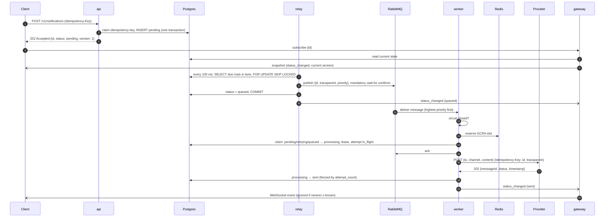
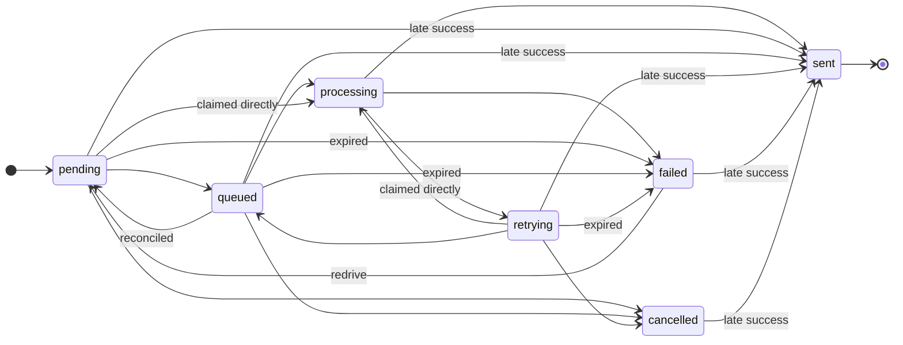

# Architecture

> **Regenerated after implementation.** This version was updated for consistency with the architecture decision records after the design review. It describes the design, not yet the code. It is regenerated from the implemented system at the end of the project; until then, the evidence listed in the requirements map is marked "planned".

An event-driven notification service that accepts SMS, Email and Push notifications through a REST API and delivers them asynchronously through an external provider, with:

- a rate limit of at most **100 messages per second per channel**;
- strict priority;
- intelligent retries;
- real-time status tracking.

This document is the entry point. It gives the overall picture; every decision is explained in an [Architecture Decision Record](#architecture-decision-records), including the alternatives that were rejected and why. Known limitations, the interpretations adopted where the requirements are open, and deferred items are listed in [future work](future-work.md).

## Design principles

1. **Postgres is the source of truth.** Every notification, its state and its full attempt history live in Postgres. The broker only carries pointers to work that is ready now.
2. **The backlog lives in the database, not the broker.** Bursts are expected by design (see [Bursts and backpressure](#bursts-and-backpressure)); RabbitMQ holds a small, bounded buffer.
3. **Every race on a notification is decided by a conditional `UPDATE` on `notifications`.** No guarantee depends on a process being the only one of its kind, so there is no leader election and no distributed lock.
4. **Failures are classified by scope.** A failure that is certainly the provider's (credentials, throttling, an unreachable host) opens a circuit and consumes no message's retry budget. A failure that may be the message's (a `5xx`, an ambiguous timeout) consumes that message's budget and counts toward the circuit.
5. **Every claim is measurable.** Priority, isolation, rate limiting and loss-free delivery are verified by tests whose results are published, and the tests themselves are checked by mutation.

## Requirements map

Requirements are numbered R1 to R36 and paraphrased here. The Evidence column names the test or command that demonstrates each one; all entries are **planned** until the implementation exists.

| ID | Requirement | Where it is addressed | Evidence (planned) |
|---|---|---|---|
| R1 | Three channels: SMS, Email, Push | [ADR-0005](adr/0005-service-topology-and-status-events.md), [ADR-0006](adr/0006-api-contract-and-three-layer-idempotency.md) §5 | `make test-e2e`: one notification per channel reaches `sent` |
| R2 | High volume, millions of notifications per day | [ADR-0001](adr/0001-rabbitmq-as-dispatch-broker.md): 291 msg/s, about 25.1 M per day | `make load`: phase 2 drain rate |
| R3 | Burst traffic | [ADR-0003](adr/0003-bounded-relay-buffer-and-sweepers.md): HWM and backpressure | `make load`: phase 1, 1 M ingest with flat broker depth |
| R4 | Reliable delivery | [ADR-0002](adr/0002-postgres-as-outbox-scheduler-and-retry-delay.md), [ADR-0003](adr/0003-bounded-relay-buffer-and-sweepers.md), [ADR-0004](adr/0004-data-model-state-machine-and-fencing.md) | `TestE2E_IdleSingleNotificationIsSent`, `TestClaim_WaitsForRelayCommit`; chaos: RabbitMQ wiped, all rows `sent` |
| R5 | Intelligent retries | [ADR-0007](adr/0007-retry-policy-and-circuit-breaker.md) §1–4, §7 | `decideRetry` table tests; chaos: low-traffic provider outage ends with `failures = 0` |
| R6 | Visibility of delivery status; real-time tracking | [ADR-0004](adr/0004-data-model-state-machine-and-fencing.md) §6 (attempt history), [ADR-0005](adr/0005-service-topology-and-status-events.md), [ADR-0009](adr/0009-observability.md) | `GET /v1/notifications/{id}/attempts` contract test; WebSocket snapshot test |
| R7 | Implemented in Go 1.2x | Go 1.26 or later | `go.mod`; CI `lint` and `unit` jobs |
| R8 | Create a notification with recipient, channel, content and priority | [ADR-0006](adr/0006-api-contract-and-three-layer-idempotency.md) §2–5 | Contract tests for `POST /v1/notifications` |
| R9 | Batch creation, up to 1,000 per request | [ADR-0006](adr/0006-api-contract-and-three-layer-idempotency.md) §6: partial success | Batch tests: 1,000 accepted, 1,001 → `422`, partial success |
| R10 | Query status by ID | [ADR-0006](adr/0006-api-contract-and-three-layer-idempotency.md) §2 | Contract test for `GET /v1/notifications/{id}` |
| R11 | Query status by batch ID | [ADR-0006](adr/0006-api-contract-and-three-layer-idempotency.md) §2 | Contract test for `GET /v1/batches/{id}` |
| R12 | Cancel pending notifications | [ADR-0004](adr/0004-data-model-state-machine-and-fencing.md) transition 9; [ADR-0006](adr/0006-api-contract-and-three-layer-idempotency.md) §7 | `TestCancel_RacesWithClaim`, `TestCancel_DuringRelayPublish`, `TestCancel_Idempotent` |
| R13 | List with filters (status, channel, date range) and pagination | [ADR-0006](adr/0006-api-contract-and-three-layer-idempotency.md) §8: keyset cursor | Pagination walk test (500 rows, `limit=7`); `EXPLAIN` check |
| R14 | Asynchronous processing by queue workers | [ADR-0001](adr/0001-rabbitmq-as-dispatch-broker.md), [ADR-0005](adr/0005-service-topology-and-status-events.md) | `make test-e2e`; `TestClaim_TwoWorkersExactlyOne` |
| R15 | At most 100 messages per second per channel | [ADR-0007](adr/0007-retry-policy-and-circuit-breaker.md) §5: GCRA at 97 msg/s, zero burst | `make load`: 30,000 SMS, no one-second window above 100; deterministic pacer test; `load-smoke` in CI |
| R16 | Priority queue (high, normal, low) | [ADR-0001](adr/0001-rabbitmq-as-dispatch-broker.md): strict priority in quorum queues; [ADR-0003](adr/0003-bounded-relay-buffer-and-sweepers.md): HWM per lane | `TestRelay_PrioritySetOnEveryMessage`; `make load`: strict-priority ordering |
| R17 | Content validation (character limits, required fields) | [ADR-0006](adr/0006-api-contract-and-three-layer-idempotency.md) §5: per channel, after rendering | SMS segment and validator unit tests; fuzz tests |
| R18 | Idempotency to prevent duplicate sends | [ADR-0006](adr/0006-api-contract-and-three-layer-idempotency.md) §11: request, record and send layers | `TestIdempotencyKey_ConcurrentSameKey`; `dedupe_key` tests; `make load`: each key received exactly once |
| R19 | Delivery and retry logic, designed by the candidate | [ADR-0007](adr/0007-retry-policy-and-circuit-breaker.md); [ADR-0004](adr/0004-data-model-state-machine-and-fencing.md) | Classification and `decideRetry` unit tests; breaker state-machine tests |
| R20 | Real-time metrics endpoint: queue depth, success and failure rates, latency | [ADR-0009](adr/0009-observability.md) §1–2: `GET /v1/metrics/summary` and Prometheus | Summary values on a known dataset; `curl localhost:8080/v1/metrics/summary` |
| R21 | Structured logging with correlation IDs | [ADR-0009](adr/0009-observability.md) §4–5 | Logging test; PII canary scan in `make test-e2e` |
| R22 | Health check endpoint | [ADR-0009](adr/0009-observability.md) §7: on the api's public port | Health endpoint tests; `curl localhost:8080/healthz` |
| R23 | Use webhook.site as the provider, with the given request format | [ADR-0007](adr/0007-retry-policy-and-circuit-breaker.md) §6; [ADR-0005](adr/0005-service-topology-and-status-events.md) | Provider client test (body has exactly three fields); `make demo` against the default URL |
| R24 | Expected response: `202` with `messageId`, `status`, `timestamp` | [ADR-0007](adr/0007-retry-policy-and-circuit-breaker.md) §2, §6 | Provider client tests: `202` parsed, other `2xx` is success with a warning |
| R25 | **Bonus:** failure handling | [ADR-0007](adr/0007-retry-policy-and-circuit-breaker.md) §1, §7, §9–10; [ADR-0003](adr/0003-bounded-relay-buffer-and-sweepers.md) | Chaos scenarios in `make test-e2e` |
| R26 | **Bonus:** scheduled notifications | [ADR-0008](adr/0008-templates-and-scheduling.md); [ADR-0002](adr/0002-postgres-as-outbox-scheduler-and-retry-delay.md) | E2E scheduled-delivery scenario; scheduling validation tests |
| R27 | **Bonus:** template system with variable substitution | [ADR-0008](adr/0008-templates-and-scheduling.md) | Template allow-list and rendering tests; e2e template scenario |
| R28 | **Bonus:** WebSocket updates | [ADR-0005](adr/0005-service-topology-and-status-events.md); [ADR-0006](adr/0006-api-contract-and-three-layer-idempotency.md) §10 | E2E: create → subscribe → snapshot and events → `sent` |
| R29 | **Bonus:** distributed tracing | [ADR-0009](adr/0009-observability.md) §6 | Trace propagation test with an in-memory exporter |
| R30 | **Bonus:** GitHub Actions CI/CD | [ADR-0010](adr/0010-testing-and-ci.md) §5–6 | `.github/workflows/ci.yml` runs on every pull request; one release run with a test tag |
| R31 | Source repository with a clean commit history | [ADR-0010](adr/0010-testing-and-ci.md) §7 | `git log --oneline`: linear, Conventional Commits, one logical change each |
| R32 | README with setup instructions, architecture overview and API examples | README; this document | Clean-clone rehearsal following the README |
| R33 | Docker Compose, one-command setup | [ADR-0005](adr/0005-service-topology-and-status-events.md) | CI `compose-up` job runs `docker-compose up` |
| R34 | Swagger/OpenAPI documentation | [ADR-0006](adr/0006-api-contract-and-three-layer-idempotency.md) §1 | `/docs` and `/openapi.yaml`; contract tests; CI `codegen-drift` |
| R35 | Versioned database migrations | [ADR-0004](adr/0004-data-model-state-machine-and-fencing.md) §8 | CI `migrations` job: `up → down → up` |
| R36 | Test suite runnable with a single command | [ADR-0010](adr/0010-testing-and-ci.md) §4 | `make test`; `make test-docker` without Go installed |

## System overview


| Service | Role | Instances in Compose | Required dependencies | ADR |
|---|---|---|---|---|
| **api** | REST, validation, template rendering, cancel, redrive, listing, metrics summary, health endpoints | 1, stateless | Postgres only | [0006](adr/0006-api-contract-and-three-layer-idempotency.md) |
| **relay** | Publishes due rows (new, scheduled, retries) on a 100 ms ticker, enforces lane HWMs, expires rows, reconciles on reconnection, recovers stuck work | 1, restarted by the runtime | Postgres, RabbitMQ | [0002](adr/0002-postgres-as-outbox-scheduler-and-retry-delay.md), [0003](adr/0003-bounded-relay-buffer-and-sweepers.md), [0005](adr/0005-service-topology-and-status-events.md) |
| **worker** | Pacing, rate limiting, circuit breaking, provider calls, delivery transitions | 1 container for all channels | Postgres, RabbitMQ; Redis with a fallback | [0005](adr/0005-service-topology-and-status-events.md), [0007](adr/0007-retry-policy-and-circuit-breaker.md) |
| **gateway** | WebSocket: snapshot on subscribe and fan-out of status events | 1 | RabbitMQ, Postgres (read-only) | [0005](adr/0005-service-topology-and-status-events.md) |
| **migrate** | Applies migrations, then exits | One-shot | Postgres | [0004](adr/0004-data-model-state-machine-and-fencing.md) |
| **mockprovider** | Fault-injecting fake provider for automated tests and load tests; not the default target | Tests only | — | [0010](adr/0010-testing-and-ci.md) |

## Lifecycle of a notification



If the worker receives the message before the relay's commit, its claim waits on the row lock and succeeds after the commit ([ADR-0004](adr/0004-data-model-state-machine-and-fencing.md), transition 3).

The full state machine, with all 12 transitions and their guards, is in [ADR-0004](adr/0004-data-model-state-machine-and-fencing.md):



`failed` and `cancelled` are final except for a late success: a result that arrives after its lease expired and proves the message was delivered moves the row to `sent` (transition 12).

## Bursts and backpressure

| Quantity | Value |
|---|---|
| Pacing rate | 97 msg/s per channel, so that no one-second window exceeds 100 |
| Delivery capacity | 3 channels × 97 msg/s = **291 msg/s**, about **25.1 M per day** |
| 1 M SMS burst | About 2.8 hours to drain through the SMS channel |
| RabbitMQ buffer | At most 2,000 distinct notifications per channel (HWM per lane: high 500, normal 1,000, low 500), about 20 seconds of work; duplicates possible |
| Largest burst a channel can drain within the default TTL | `high` (10 min) ≈ 58,800; `normal` (6 h) ≈ 2.1 M; `low` (24 h) ≈ 8.5 M |

The burst backlog waits in Postgres. When a provider fails, the system slows down step by step without explicit coordination:

```
provider fails → circuit opens → the pacer stops claiming → messages wait in the queue
→ lanes reach their HWM → relay stops publishing → backlog grows in Postgres → expired rows fail
```

Priority holds under backlog for two reasons: the relay keeps headroom for each priority (HWM per lane) and visits `high` first, and the broker delivers by strict priority within each channel's queue. Under sustained `high` traffic at a channel's full rate, `low` waits ([ADR-0001](adr/0001-rabbitmq-as-dispatch-broker.md), [ADR-0003](adr/0003-bounded-relay-buffer-and-sweepers.md)).

The backlog in Postgres is not limited; a notification's expiry time is the only bound.

## Delivery semantics

Delivery is **at-least-once**. Duplicates are prevented where the system can prevent them, and measured where it cannot:

| Duplicate source | Defence |
|---|---|
| Client retries the HTTP request | `Idempotency-Key`: the stored response is replayed ([ADR-0006](adr/0006-api-contract-and-three-layer-idempotency.md)) |
| The same business event in different requests | `dedupe_key`, unique unless cancelled before any attempt ([ADR-0006](adr/0006-api-contract-and-three-layer-idempotency.md)) |
| Duplicate messages from republishing or reconciliation | Conditional claim: only one copy is processed ([ADR-0004](adr/0004-data-model-state-machine-and-fencing.md)) |
| A stalled worker resuming after its lease expired | The fencing token rejects its write; a late success moves the row to `sent` instead of resending ([ADR-0004](adr/0004-data-model-state-machine-and-fencing.md)) |
| The HTTP client repeating a request | Redirects are not followed and transport replays are disabled ([ADR-0007](adr/0007-retry-policy-and-circuit-breaker.md) §11) |
| An attempt whose result is unknown | Retried with `Idempotency-Key: <notification_id>` to the provider ([ADR-0007](adr/0007-retry-policy-and-circuit-breaker.md) §6) |

**Every attempt that ends `unknown` can produce a duplicate with a provider that ignores idempotency keys, and webhook.site does.** An attempt ends `unknown` after a timeout that follows a sent request, when a worker dies after the provider answered, or when a database outage outlasts the worker's final-write retries. The load and chaos tests count duplicates at the provider and report them ([ADR-0010](adr/0010-testing-and-ci.md)).

## Failure handling

| Failure | Effect | Recovery | Chaos scenario |
|---|---|---|---|
| RabbitMQ down | The api keeps accepting; the backlog grows in Postgres | The relay reconnects, reconciles and republishes | Yes |
| RabbitMQ loses its data | Queued messages are gone; topology is gone | Every role redeclares the topology; reconciliation returns `queued` rows to `pending` | Yes |
| Postgres down | Requests return `503`; workers cannot claim; final writes are retried for 60 s | Automatic once it returns; sends finished during a long outage may be repeated | Yes |
| Redis down | The worker switches to an in-process limiter; the rate limit is approximate | Automatic | Yes |
| Provider failing | Circuit opens; retry budgets are preserved | Half-open probes close the circuit | Yes |
| Provider unreachable at low traffic | Circuit opens after 5 consecutive failures; no budget is consumed | Half-open probes | Yes |
| Worker killed mid-send | Row stuck in `processing` | Lease sweeper (transition 7) | Yes |
| Relay stopped | Publishing, expiry and recovery pause; nothing is lost | Restarted by the container runtime | No (start-up path covered by integration tests) |
| Message lost while the relay stays connected | Row stays `queued` | Oldest-queued-age alert, manual `requeue-stale`, or expiry | No |
| Unroutable publish | Row stays `pending` | Topology is redeclared on connection; published on a later cycle | No (integration test) |
| webhook.site URL expired or capped | Circuit opens (provider-scoped) | Create a new URL and set `PROVIDER_URL` | No |

Details: [ADR-0007](adr/0007-retry-policy-and-circuit-breaker.md) §10. The last column says which rows have a chaos scenario in [ADR-0010](adr/0010-testing-and-ci.md) §1; the others are covered by integration tests or are operational procedures.

## Technology

Every container image is pinned to an exact tag in `docker-compose.yml`. The exact patch versions are chosen when the repository skeleton is created and are recorded here when this document is regenerated.

| Concern | Choice | Version |
|---|---|---|
| Language | Go | 1.26 or later (required by the code generator) |
| HTTP | `net/http` (standard `ServeMux`), with handlers generated by `oapi-codegen` in strict-server mode from `api/openapi.yaml` | |
| Database | PostgreSQL, `pgx`, `sqlc`, `golang-migrate`; UUIDv7 from `google/uuid` | PostgreSQL 18.x |
| Broker | RabbitMQ (quorum queues with strict priority), `rabbitmq/amqp091-go` | RabbitMQ 4.4.x; client ≥ v1.13.0 |
| Rate limiting | Redis, `redis/go-redis`, one Lua script (GCRA) | Pinned tag |
| Circuit breaker | In-process state machine | — |
| WebSocket | `coder/websocket` | |
| Validation | `nyaruka/phonenumbers`, `net/mail` | |
| Observability | `log/slog`, Prometheus client, OpenTelemetry SDK (`otelhttp`, `otelpgx`), Prometheus, Grafana, Jaeger | Jaeger 2.x; pinned tags |
| Testing | `testing`, `testcontainers-go`, `kin-openapi`, k6 | |
| CI/CD | GitHub Actions (actions pinned by commit SHA), `golangci-lint`, `govulncheck`, `trivy`, GHCR | golangci-lint v2 |

## Repository layout

```
cmd/{api,relay,worker,gateway,migrate,mockprovider}/   wiring only
internal/
  domain/      state machine, decideRetry, classification: pure, no I/O
  store/       sqlc queries; transition functions returning StatusChanged
  queue/       RabbitMQ topology, publisher, consumers, event publisher
  ratelimit/   GCRA (Redis) and in-process fallback
  breaker/     in-process circuit breaker
  provider/    Provider interface; webhook implementation
  api/ relay/ worker/ gateway/
  platform/    config, logging, metrics, tracing, shutdown
api/openapi.yaml
migrations/
deploy/        Prometheus, Grafana and Jaeger configuration
docs/          this document, ADRs, future work, plan, load-test results
```

## Architecture decision records

| ADR | Decision |
|---|---|
| [0001](adr/0001-rabbitmq-as-dispatch-broker.md) | RabbitMQ 4.4 with quorum queues as the dispatch broker: one queue per channel, strict priority, mandatory publishes, a topic exchange for status events |
| [0002](adr/0002-postgres-as-outbox-scheduler-and-retry-delay.md) | Postgres as outbox, scheduler and retry-delay store, unified under one `due_at` key; a relay on a 100 ms ticker |
| [0003](adr/0003-bounded-relay-buffer-and-sweepers.md) | High-water mark per lane, the backpressure chain, reconciliation on reconnection, the lease sweeper |
| [0004](adr/0004-data-model-state-machine-and-fencing.md) | Data model, the 12-transition state machine, the claim guard, leases and fencing tokens |
| [0005](adr/0005-service-topology-and-status-events.md) | Service topology, a single relay, the worker's pacer loop, ordered status events with a snapshot on subscribe |
| [0006](adr/0006-api-contract-and-three-layer-idempotency.md) | Contract-first API, validation, batch semantics, WebSocket protocol, three-layer idempotency |
| [0007](adr/0007-retry-policy-and-circuit-breaker.md) | Failure classification by scope, back-off profiles, GCRA rate limiting at 97 msg/s, in-process circuit breaker, the provider contract |
| [0008](adr/0008-templates-and-scheduling.md) | Constrained standard-library templates with immutable versions; scheduling rules |
| [0009](adr/0009-observability.md) | Metrics and summary endpoint, PII-safe structured logging, hybrid tracing, health checks |
| [0010](adr/0010-testing-and-ci.md) | Test layers, the actor-pair matrix, load-test evidence, suite verification by mutation, CI/CD pipelines |
